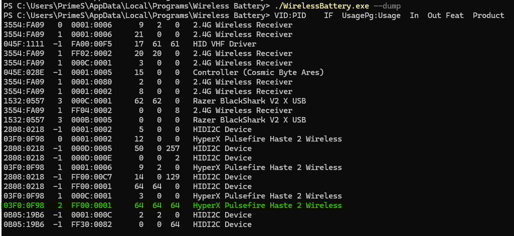
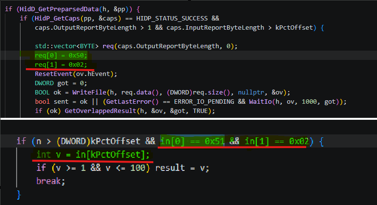
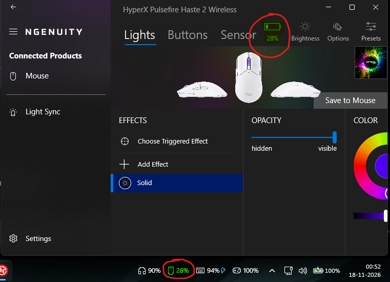

# HyperX Pulsefire Haste 2 Wireless — Battery Monitor

A lightweight Windows taskbar battery monitor for the **HyperX Pulsefire Haste 2 Wireless** mouse.

The application uses Windows HID communication to retrieve the mouse's battery percentage through its 2.4 GHz wireless receiver and displays it directly on the Windows taskbar.

---

# Reverse Engineering the HID Battery Protocol

## 1. Introduction

The HyperX Pulsefire Haste 2 Wireless does not expose its battery percentage through a standard Windows battery interface. To retrieve the battery level, it is necessary to communicate with the device through its Human Interface Device (HID) interface.

This project involved investigating the device's HID collections, identifying the vendor-specific communication interface, analysing its request and response reports, and implementing the battery-query mechanism in C++.

The objective was to identify the minimum communication required to retrieve the battery percentage without modifying the device's configuration or other settings.

## 2. Device Identification

The device was connected through its 2.4 GHz USB wireless receiver.

| Property | Value |
|---|---|
| Device | HyperX Pulsefire Haste 2 Wireless |
| Vendor ID (VID) | `03F0` |
| Product ID (PID) | `0F98` |
| Connection | 2.4 GHz wireless receiver |
| Windows interface identifier | `MI_02` |
| HID interface index in diagnostic output | `2` |
| Usage Page | `0xFF00` |
| Usage | `0x0001` |

## 3. HID Interface Investigation

The first step was to enumerate the HID collections exposed by the wireless receiver.

The diagnostic output showed multiple interfaces associated with the same VID and PID.

### Identified HID interfaces

| Interface | Usage Page | Usage | Input | Output | Feature |
|---|---|---|---:|---:|---:|
| 0 | `0x0001` | `0x0002` | 12 | 0 | 0 |
| 1 | `0x0001` | `0x0006` | 9 | 2 | 0 |
| 1 | `0x000C` | `0x0001` | 3 | 0 | 0 |
| 2 | `0xFF00` | `0x0001` | 64 | 64 | 64 |

The vendor-defined HID collection was identified as the relevant communication interface.

Its properties were:

- Interface index: `2`
- Usage Page: `0xFF00`
- Usage: `0x0001`
- Input report length: 64 bytes
- Output report length: 64 bytes
- Feature report length: 64 bytes

The Windows implementation identifies this collection using the `MI_02` interface identifier in the device path.

### HID interface enumeration



## 4. Reverse-Engineering the Battery Protocol

After identifying the relevant HID collection, the next step was to determine how to request the battery percentage.

The working implementation sends a 64-byte output report.

### 4.1 Battery Request

The first two bytes of the request are:

```text
50 02
```

The remaining bytes are zero-padded.

The complete request structure is:

```text
50 02 00 00 00 00 ... (64 bytes total)
```

### 4.2 Battery Response

The device returns an input report beginning with:

```text
51 02
```

The response header is used to identify the expected battery-query response.

The battery percentage is stored at **byte index 2 (zero-based indexing)**.

### Response structure

| Byte Index | Description |
|---:|---|
| 0 | Response marker: `0x51` |
| 1 | Response identifier: `0x02` |
| 2 | Battery percentage |
| 3 onward | Not interpreted by this implementation |

### 4.3 Extracting the Battery Percentage

For example, consider the following response prefix:

```text
51 02 1D ...
```

The third byte is:

```text
0x1D = 29 (decimal)
```

Therefore, the reported battery percentage is:

```text
29%
```

The implementation validates the response header before extracting the battery percentage and accepts values in the range of 0–100.

**Note:** The example above illustrates byte interpretation. It is not presented as a complete captured 64-byte response.

## 5. Implementation in C++

The protocol was implemented using the Windows HID API and SetupAPI.

The application performs the following operations:

1. Enumerates the available HID device interfaces.
2. Identifies the device using VID `03F0` and PID `0F98`.
3. Selects the `MI_02` interface.
4. Opens the HID device for read and write access.
5. Retrieves the report lengths using HID preparsed data.
6. Constructs and sends the 64-byte battery request.
7. Reads the input report using overlapped I/O with a timeout.
8. Validates the response header (`51 02`).
9. Extracts the battery percentage from byte index 2.
10. Updates the taskbar display.

### Important implementation details

The application uses the report lengths reported by the HID device instead of assuming that every HID collection has the same report size.

The battery request is read-only. It does not modify DPI, polling rate, lighting, profiles or other mouse configurations.

The application periodically polls the device and displays the latest successfully retrieved battery percentage.

### Protocol implementation

The following code illustrates the request and response handling used in the Windows application.

**Battery request:**

```cpp
req[0] = 0x50;
req[1] = 0x02;
```

**Response validation and extraction:**

```cpp
if (n > 2 && in[0] == 0x51 && in[1] == 0x02) {
    int battery = in[2];

    if (battery >= 0 && battery <= 100) {
        // Battery percentage retrieved successfully
    }
}
```

The actual implementation additionally handles HID report lengths, asynchronous I/O, timeouts and device access.

### Implementation screenshot



## 6. Validation Against HyperX NGENUITY

The implementation was tested using a physical HyperX Pulsefire Haste 2 Wireless mouse and its 2.4 GHz receiver.

The battery percentage retrieved through the custom HID implementation was compared with the percentage displayed by the official HyperX NGENUITY software.

Both applications displayed the same battery percentage during testing.

### Battery percentage comparison



This provided an additional validation point that the extracted value represented the actual battery percentage.

## 7. Limitations and Scope

This investigation focuses specifically on retrieving the battery percentage from the HyperX Pulsefire Haste 2 Wireless.

The following aspects have not been reverse-engineered or verified:

- The complete proprietary HyperX NGENUITY communication protocol.
- The meaning of all remaining bytes in the 64-byte response.
- DPI, polling-rate and lighting configuration commands.
- Firmware-update or profile-management communication.
- Protocol compatibility with other HyperX mouse models.
- Behaviour across every firmware version and connection mode.

The findings should therefore be considered specific to the tested device and its 2.4 GHz receiver.

Only the battery-query operation described in this documentation has been implemented and validated.

## 8. Conclusion

This project demonstrates how a device-specific HID protocol can be investigated and implemented to retrieve battery information that is not exposed through a standard Windows battery interface.

By identifying the correct vendor-defined HID collection, determining the battery request and response format, and locating the battery percentage within the response, a working Windows battery-monitoring application was developed.

The implementation was tested on physical hardware and its battery readings matched HyperX NGENUITY.

The protocol findings were also used to contribute support for the HyperX Pulsefire Haste 2 Wireless to the [Wireless Device Battery Monitor](https://github.com/krisgfx9/Wireless-Device-Battery-Monitor) project.

---

# Credits and References

- **Original device-support research and implementation:** [uzumakiprime](https://github.com/uzumakiprime)
- **Wireless Device Battery Monitor:** [krisgfx9/Wireless-Device-Battery-Monitor](https://github.com/krisgfx9/Wireless-Device-Battery-Monitor)
- **HyperX:** [Official website](https://hyperx.com/)
